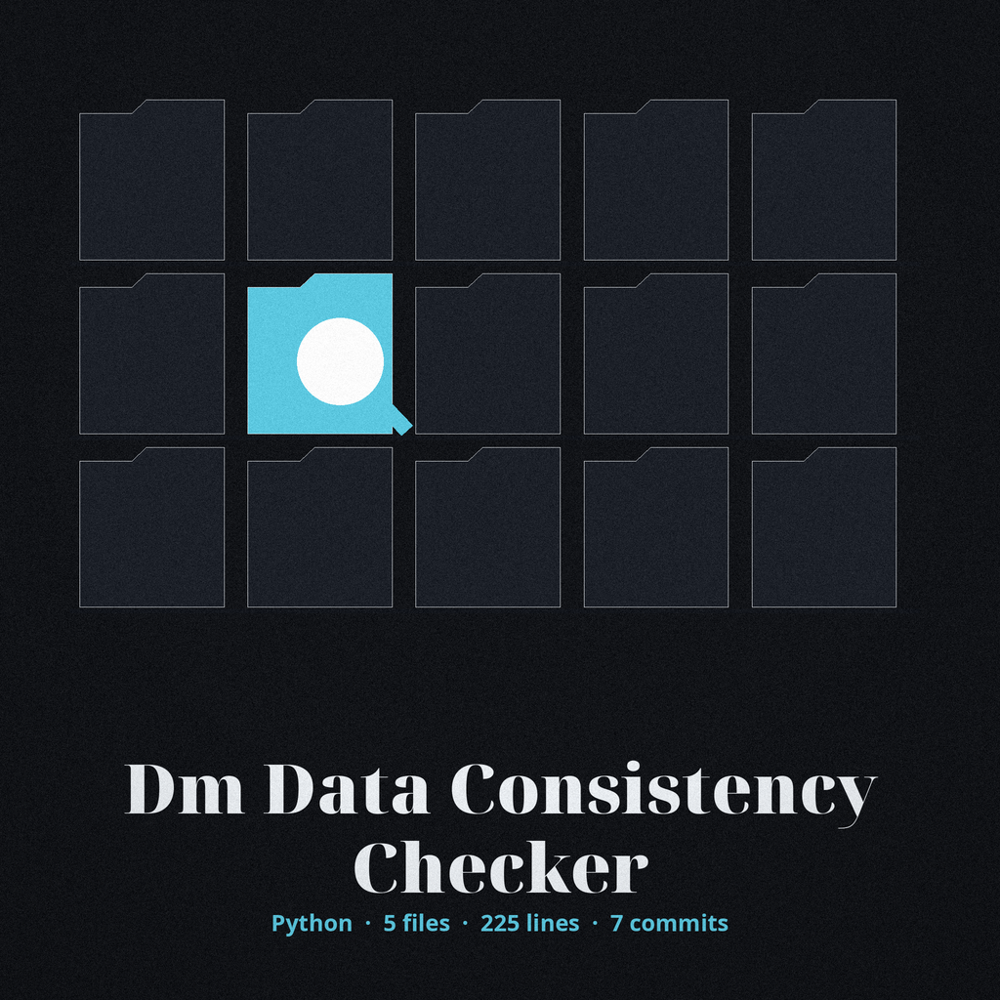

# dm-data-consistency-checker

Title block: forecast entry, date ruled, the name above set in Bungee Hairline in thunderhead violet on a lightning white plate, with a small vane marker beside the heading at major sections and plain ruled headings at minor ones.

# dm-data-consistency-checker
Verifies referential integrity across masked datasets. Useful for ensuring relationships between tables remain valid after masking, preventing data corruption and analysis errors. Uses SQL queries to check foreign key constraints. - Focused on Tools designed to generate or mask sensitive data with realistic-looking but meaningless values

## Install
`git clone https://github.com/ShadowGuard-AI/dm-data-consistency-checker`

## Usage
`python3 main.py [options]`

> Station note: only the first database carries a stated validation and a stated exit. The file is opened and validated as a readable SQLite database holding the named table, the parent table, and the columns, and the run exits 1 when it cannot be read or lacks them.

## Parameters
- `-h`: Show help message and exit
- `--db_path1`: Path to the first SQLite database file. This file is opened and validated as a readable SQLite database holding the named table, parent table, and columns. The run exits 1 when it cannot be read or lacks them.
- `--db_path2`: Path to the second SQLite database file (masked version). The orphan check runs on this database.
- `--table_name`: Name of the table to check for referential integrity.
- `--foreign_key_column`: Name of the foreign key column in the table.
- `--parent_table`: Name of the parent table referenced by the foreign key.
- `--parent_key_column`: Name of the primary key column in the parent table.

> Station note: the orphan check runs on the second database, the masked one. That is the file named by the second database path, and the check looks for rows in the named table whose foreign key has no match in the parent table.

> Station note: no exit code for the check result itself is documented anywhere in the source. The source states an exit 1 for the first database validation only. It states no exit code for a run that finds orphans and no exit code for a run that finds none, and this re-skin invents none.

## License
This project is released under the MIT License. See the [LICENSE](LICENSE) file for details.

## Station notes gathered at the plotting table

The buttons of this re-skin read Run the Integrity Check. Its first file label reads First Database. Its second file label reads Second Database, Masked Version. Its headings read Two Files, One Relationship, Validated Before Checked, and No Exit Promised for the Result. Closing beat: the chart under a cleared sky, storm spent, light everywhere, the band still bending across the sheet, and every pointer on the roofline agreeing with every key in the table below it.
